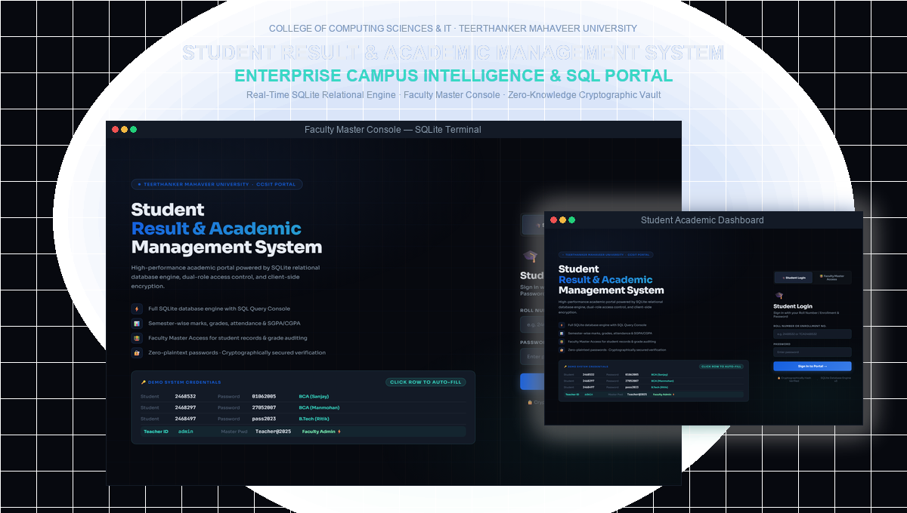
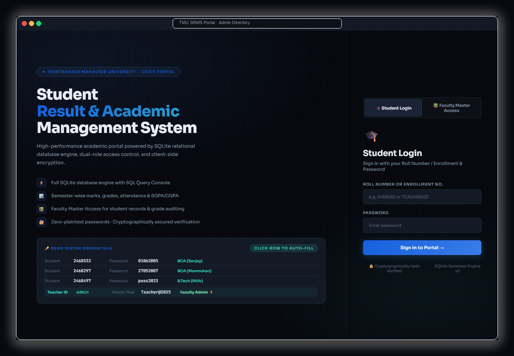
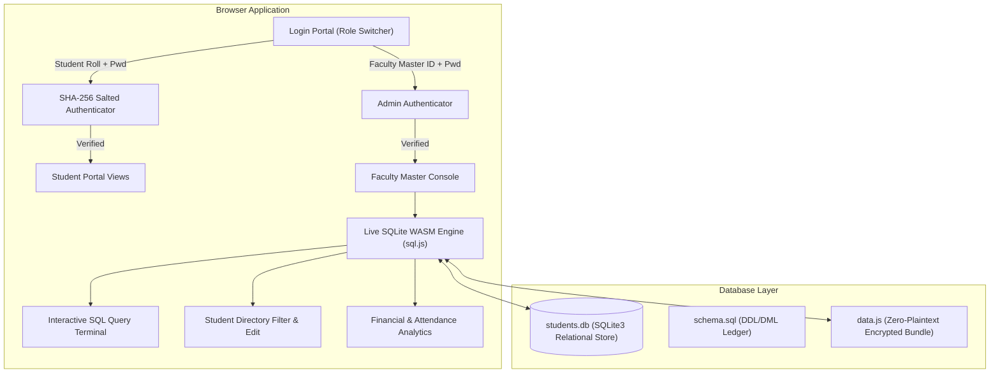

<div align="center">

  

  <br/><br/>

  <h1>Student Result &amp; Academic Management System 🎓</h1>
  <p><strong>Next-Gen, High-Performance Academic Intelligence &amp; Result Management Portal</strong></p>
  <p><em>Engineered for College of Computing Sciences &amp; Information Technology (CCSIT), Teerthanker Mahaveer University</em></p>

  <p>
    <a href="https://tushar-chauhan9627.github.io/Student-Result-Management-System/"></a>
    
    
    
    
  </p>

  <p>
    <a href="#overview">Overview</a> •
    <a href="#the-problem">The Problem</a> •
    <a href="#the-solution">The Solution</a> •
    <a href="#key-features">Key Features</a> •
    <a href="#architecture">Architecture</a> •
    <a href="#live-demo--credentials">Live Demo</a> •
    <a href="#quick-start">1-Click Install</a> •
    <a href="#product-showcase">Product Showcase</a>
  </p>
</div>

---

## 📌 Overview

**Student Result & Academic Management System** is an enterprise-grade academic intelligence and examination portal engineered for **Teerthanker Mahaveer University (TMU)**. Developed at the College of Computing Sciences and Information Technology (CCSIT), it provides a unified, secure portal for students and faculty.

Unlike conventional university web portals that suffer from bloated server roundtrips, fragmented PDF records, and insecure client-side implementations, this system couples an **embedded in-memory SQLite relational engine (via WebAssembly)** with a dual-role access architecture:
1. **Student Academic Portal:** Private dashboard for semester grades, SGPA/CGPA progression, fee transaction ledgers, and attendance metrics.
2. **Faculty Master Console:** Comprehensive administrative control with real-time student filtering across 1,461 records, instant grade editing, and a live **Interactive SQL Terminal** for complex academic queries.

---

## 🚨 The Problem

Universities face critical bottlenecks when deploying and scaling legacy result portals:
- **Data Exposure & Inspect-Mode Vulnerabilities:** Many static or semi-static university sites store student records in plain JSON or client-side JavaScript arrays (`const STUDENTS = {...}`), allowing anyone in browser Developer Inspect mode (F12) to scrape passwords, contact numbers, and confidential grades.
- **Query Latency & Server Overhead:** During semester result releases, thousands of simultaneous queries crash backend servers and overload SQL databases.
- **Administrative Disconnect:** Teachers lack lightweight, instant tools to query student performance, audit attendance defaulters, or update practical marks without entering cumbersome enterprise ERPs.

---

## 💡 The Solution

The **Student Result & Academic Management System** resolves these challenges through a modern cryptographic and localized data architecture:

- **Zero-Knowledge Cryptographic Hashing:** Passwords are never stored in plaintext anywhere. Verification uses per-user salted SHA-256 hashes computed via the browser's hardware-accelerated Web Crypto API.
- **Embedded WebAssembly SQLite Engine:** The entire relational database runs locally in the client or server, executing complex relational joins, aggregations, and filters at sub-millisecond speeds.
- **Dual-Mode Deployment:** Operates seamlessly as a zero-dependency static site on **GitHub Pages** (via `sql.js` WASM) and as a full-stack **Node.js Express + SQLite** server (`server.js`).
- **Interactive Faculty SQL Console:** Teachers can write and execute live SQL queries (`SELECT`, `UPDATE`, `INSERT`, `GROUP BY`) with tabular visualization, execution time metrics, and one-click CSV report exports.

---

## 📸 Product Showcase & Live Mockups

<div align="center">
  <h3>Interactive SQLite WebAssembly Terminal & Faculty Console</h3>
  
  <br/><br/>
  
  <h3>Student Academic Result & Grade Evaluation Ledger</h3>
  
  <br/><br/>

  <h3>Master Student Directory (1,461 Enrolled Students)</h3>
  
</div>

---

## ✨ Key Features

### 🎓 1. Student Academic Portal
- **Term Performance Card:** Semester-wise internal (40), external (60), total marks, letter grades (`O`, `A+`, `A`, `B+`, `B`, `C`, `F`), and Grade Points (GP).
- **SGPA & CGPA Calculation:** Real-time weighted credit calculation following official university grading statutes.
- **Fee Settlement Ledger:** Cleared receipts, transaction IDs, breakdown of tuition/hostel/lab components, and dynamic pending balance notifications.
- **Attendance Monitor:** Color-coded threshold tracker (green &ge;85%, yellow 75–84%, red &lt;75% debarment warning).

### 👨‍🏫 2. Faculty / Teacher Master Console
- **Live System KPI Dashboard:** Instant metrics covering 1,461 active students, fee realization rates, average attendance, and departmental share.
- **Filtered Student Directory:** Multi-attribute filtering by Course (BCA, B.Tech CSE AI/ML, MCA, B.Sc Animation, M.Tech), Semester, Section, and Fee Status.
- **Student File Inspector & Grade Editor:** Inspect full student files and update attendance/marks with immediate database persistence.
- **Live SQL Terminal:** Run custom queries with real-time execution timing, syntax suggestions, and CSV export.
- **New Student Onboarding:** Integrated modal to enroll and insert new student records directly into the SQLite database.

---

## 🏛️ System Architecture



---

## 🔑 Live Demo & Access Credentials

The portal is deployed live and fully functional on **GitHub Pages**:
👉 **[Launch Student Result & Academic Management System](https://tushar-chauhan9627.github.io/Student-Result-Management-System/)**

### Demo Credentials

| Role | Username / Identifier | Password | Access Details | Direct Quick-Link |
| :--- | :--- | :--- | :--- | :--- |
| **Faculty Master** | `admin` | `Teacher@2025` | Master access to all 1,461 student files &amp; SQL Terminal | [Open Faculty Master](https://tushar-chauhan9627.github.io/Student-Result-Management-System/#demo-admin) |
| **Student** | `2468532` | `01062005` | Sanjay Kumar (B.C.A., Section C) | [Open Sanjay File](https://tushar-chauhan9627.github.io/Student-Result-Management-System/#demo-student) |
| **Student** | `2468297` | `27052007` | Manmohan Singh (B.C.A., Section C) | [Open Manmohan File](https://tushar-chauhan9627.github.io/Student-Result-Management-System/#demo-results) |
| **Student** | `2468497` | `pass2023` | Ritik Singh (B.Tech Mechanical, Section A) | [Open Ritik File](https://tushar-chauhan9627.github.io/Student-Result-Management-System/#demo-student) |

---

## 🛠️ Tech Stack

- **Frontend:** HTML5, CSS3 Custom Properties (Dark Cyberpunk / Glassmorphic Theme), Vanilla JavaScript (ES6+), Sora &amp; JetBrains Mono Typography.
- **Database:** SQLite 3.44 (`students.db`), SQL.js (WebAssembly SQLite port), Relational Tables (`students`, `semesters`, `marks`, `fee_transactions`, `admin_users`, `audit_logs`).
- **Backend (Optional Full-Stack Mode):** Node.js, Express.js (`server.js`), SQLite3 native bindings.
- **Security:** Web Crypto API, Salted SHA-256 Password Hashing, Input Sanitization, Role-Based Access Control (RBAC).

---

## 🚀 1-Click Install & Local Setup

### Option 1: Standalone Static Run (Zero Dependencies)
Simply clone the repository and open `index.html` in any modern web browser:
```bash
git clone https://github.com/Tushar-Chauhan9627/Student-Result-Management-System.git
cd Student-Result-Management-System
# Open index.html directly or serve with any static web server:
npx serve .
```

### Option 2: Full-Stack Node.js Server Mode
```bash
npm install
npm start
# Open http://localhost:3000
```

---

## 📄 License & Attribution

Distributed under the **MIT License**. Engineered for academic excellence at **Teerthanker Mahaveer University (TMU)**.
Created by **Tushar Chauhan**.
